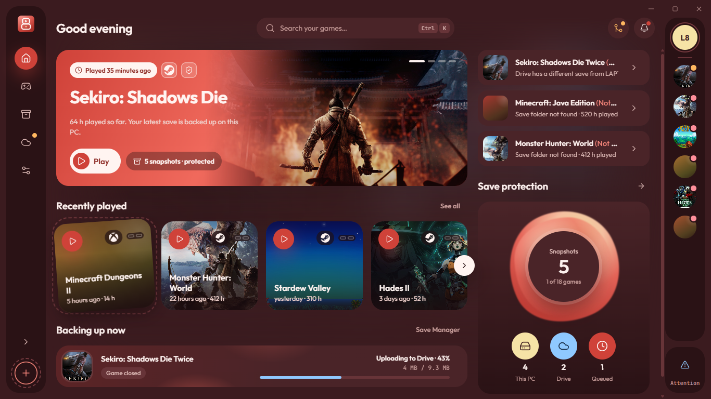
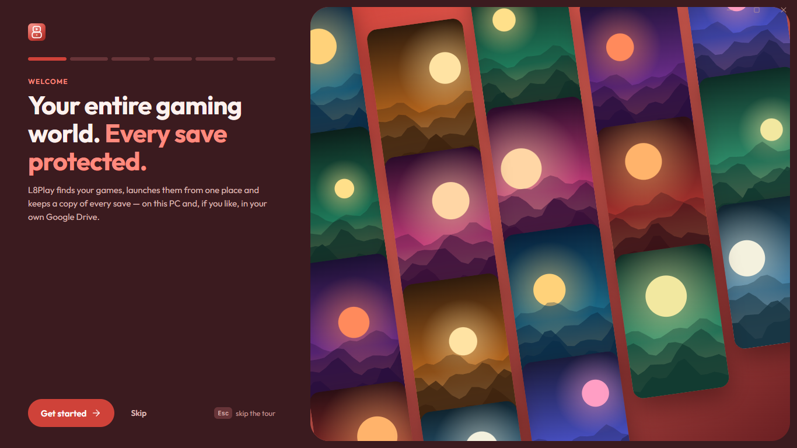
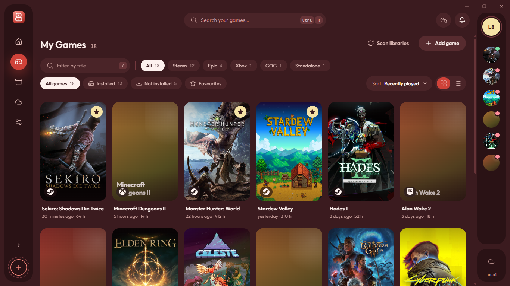
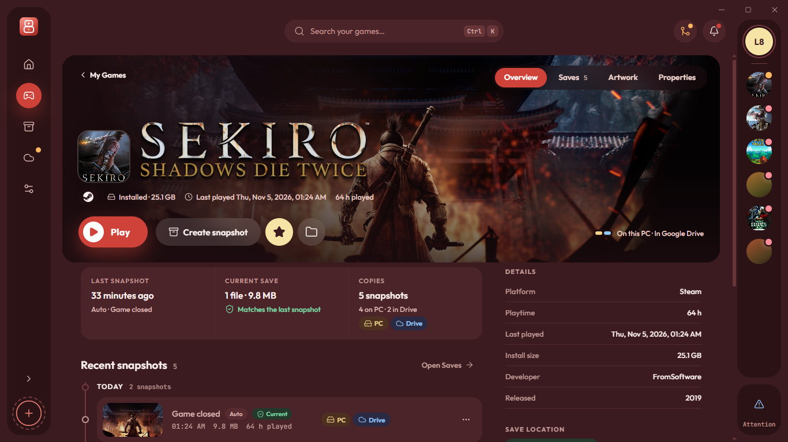
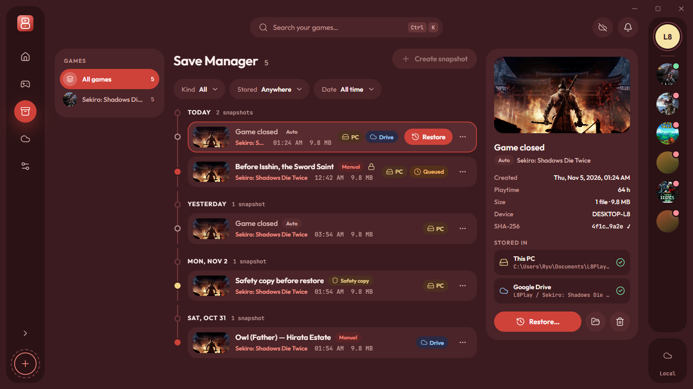
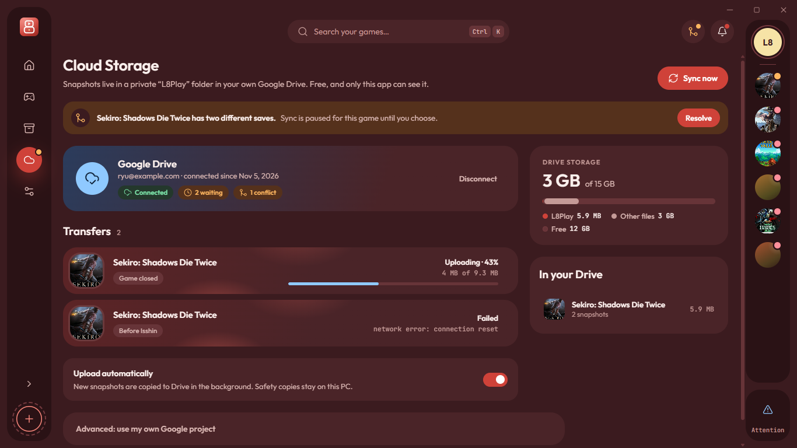
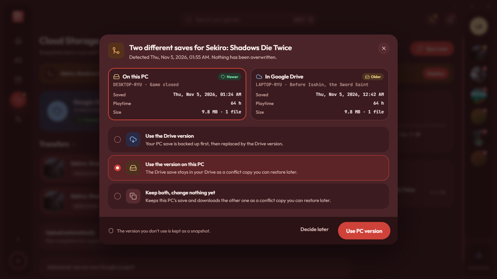
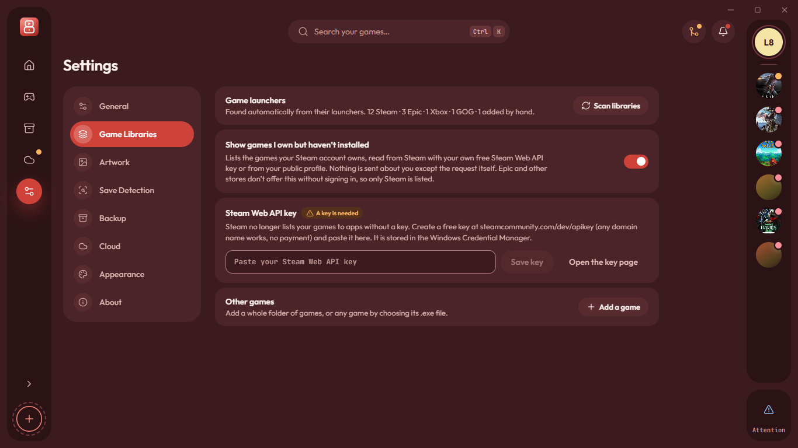
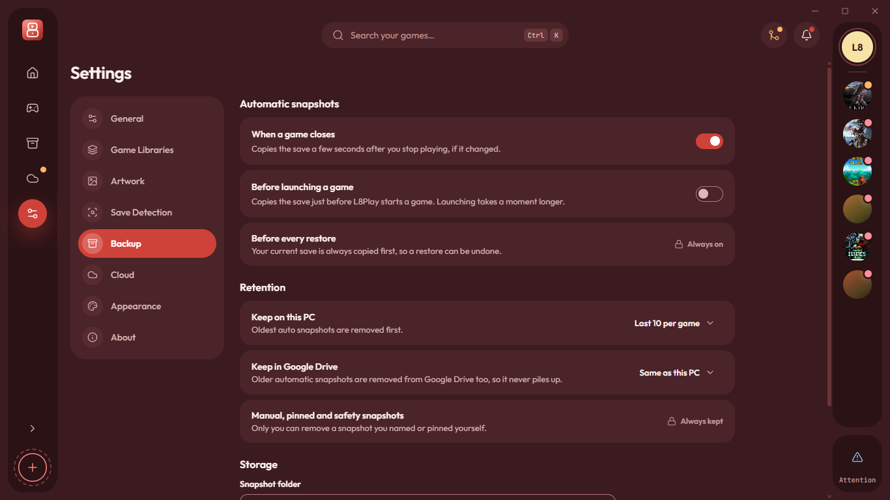

<p align="center">
  
</p>

<h1 align="center">L8Play</h1>

<p align="center">
  <strong>Your entire gaming world. Every save protected.</strong><br />
  A free Windows gaming hub: one library for your PC games, verified save snapshots,
  and optional Google Drive backup.
</p>

<p align="center">
  <a href="https://v2.tauri.app"></a>
  <a href="https://www.rust-lang.org"></a>
  <a href="https://react.dev"></a>
  <a href="https://www.typescriptlang.org"></a>
  <a href="#requirements-windows-1011-x64"></a>
  <a href="LICENSE"></a>
  
</p>

<p align="center">
  
</p>

## What it does

- **One library, every store.** L8Play finds games installed through Steam, Epic, the Xbox app and GOG, and adds any standalone game from its `.exe`. Launch everything from one place, with playtime, favourites, search and recently played.
- **Automatic save snapshots.** Save folders are detected with the bundled [Ludusavi](https://github.com/mtkennerly/ludusavi) manifest, with PCGamingWiki and local search as fallbacks. A verified zip snapshot is taken when you stop playing (optionally before launch too).
- **Safe restore.** Restoring a snapshot makes a safety copy first, stages files next to the target, verifies hashes, and rolls back every location if anything fails.
- **Your Google Drive, optional.** Keep a second verified copy in a private "L8Play" folder in your own Drive, using the `drive.file` scope. Nothing is ever overwritten silently: conflicts pause the sync and wait for your choice.
- **Artwork and metadata.** Steam CDN covers, optional SteamGridDB results with your own free key kept in the Windows Credential Manager, or an image of your own. Title, developer and release year are editable.
- **Built like a desktop app.** Tray icon, native notifications, custom title bar, keyboard-first search (`Ctrl K`), English and French, and two themes (Ember and Rosé).
- **Updates inside the app.** Settings › Updates checks GitHub Releases, shows the new version and its notes, then downloads, verifies and installs the signed installer and restarts. No paid update service.

## Screenshots

| First run | My Games |
| --- | --- |
| [](docs/screenshots/01-welcome.png) | [](docs/screenshots/03-library.png) |
| **Game details** | **Save Manager** |
| [](docs/screenshots/04-game-details.png) | [](docs/screenshots/05-save-manager.png) |
| **Cloud Storage** | **Sync conflict** |
| [](docs/screenshots/06-cloud-sync.png) | [](docs/screenshots/07-sync-conflict.png) |
| **Settings: game libraries** | **Settings: snapshots** |
| [](docs/screenshots/08-settings-libraries.png) | [](docs/screenshots/09-settings-backup.png) |

## Project status

Phases 1 to 7 are implemented: library and launching, local snapshots with safe restore, artwork and metadata, extended save detection, Google Drive sync with conflict handling, tray, notifications, welcome tour and an installer. The app is feature complete and awaiting hands-on testing on real machines; see the [hands-on testing guide](docs/testing-guide.md) and the [roadmap](docs/architecture/08-roadmap.md).

## Tech stack

| Layer | Choices |
| --- | --- |
| Desktop shell | Tauri 2, Rust 2024, WebView2 |
| Business core | `l8-core` crate: SQLite (rusqlite + migrations), Ludusavi sidecar, zip snapshots, Google Drive transport, Windows Credential Manager |
| Frontend | React 19, TypeScript 7, Vite 8, React Router 8 |
| UI | Tailwind CSS 4, Radix primitives, a custom design-system layer driven by `design/tokens.json` |
| State and data | TanStack Query, Zustand |
| Typed bridge | Commands and events generated from Rust with `ts-rs` |
| i18n | Lingui (English and French catalogues) |
| Tests | Vitest and Testing Library, `cargo test`, Clippy |

## Requirements (Windows 10/11, x64)

| Tool | Version | Notes |
| --- | --- | --- |
| [Rust](https://rustup.rs) | stable, MSVC toolchain | `rustup default stable-msvc` |
| Visual Studio Build Tools | 2022 or newer | "Desktop development with C++" workload |
| [Bun](https://bun.sh) | 1.x | package manager and script runner |
| WebView2 Runtime | any | preinstalled on Windows 10/11 |

## Getting started

```bash
bun install
```

```bash
bun tauri dev
```

`bun tauri dev` starts Vite on port 1420 and opens the native window. `bun run dev` alone opens the interface in a browser against an in-memory preview backend, with no database or file access. That mode is useful for design work and is what the screenshots above were taken with.

To build the installer:

```bash
bun tauri build
```

The NSIS installer is written to `target/release/bundle/nsis/`. See [docs/release-and-signing.md](docs/release-and-signing.md) for signing, the update manifest and GitHub Actions.

## Updates

L8Play checks GitHub Releases shortly after it starts and every six hours, unless **Settings › Updates › Check for updates automatically** is off. The check is one HTTPS request to this repository's releases; it sends nothing about you or your library. When a newer version exists, the section shows its number, publication date and release notes. **Update now** downloads the installer, verifies its minisign signature against the public key embedded in the app, installs it and restarts L8Play. A single install is enough: the plugin only accepts a higher version, so downgrades are refused.

Updates are free: GitHub Releases hosts the manifest (`latest.json`) and the installer, and the signing key pair is generated locally. The private key is never in this repository or in the app; see [release-and-signing.md](docs/release-and-signing.md).

**One-time step:** version 0.1.2 does not contain the updater, so install **0.1.3** manually once. From 0.1.3 onward, every release is offered inside the app.

## Scripts

| Command | What it does |
| --- | --- |
| `bun tauri dev` | Run the desktop app with hot reload |
| `bun tauri build` | Build the Windows installer (NSIS, per-user install) |
| `bun run build` | Type-check and build the frontend |
| `bun run typecheck` | TypeScript check (TypeScript 7) |
| `bun run lint` | ESLint |
| `bun run test` | Frontend unit tests (Vitest) |
| `cargo test --workspace` | Rust tests; also regenerates `src/lib/bindings` (ts-rs) |
| `cargo clippy --workspace --all-targets -- -D warnings` | Rust lints |
| `bun run tokens` | Regenerate `src/styles/tokens.css` from `design/tokens.json` |
| `bun run i18n:extract` | Extract UI strings and apply the French translations from `scripts/translations/fr*.json` |
| `bun run fetch:ludusavi` | Download and verify the Ludusavi sidecar used for save detection |
| `bun scripts/make-update-manifest.ts --version x.y.z --notes-file notes.md` | Build `latest.json` for the in-app updater from the built `.sig` file |

## Project layout

```
crates/l8-core/      Business logic (no Tauri): SQLite, settings, platforms (Steam, Epic, Xbox, GOG),
                     library, launcher, sessions, saves, artwork, Google Drive
src-tauri/           Desktop shell: window, tray, typed commands, logging
src/                 React app
  app/               bootstrap, router, query client
  components/        design-system components (shell, ui, feedback, game)
  features/          one folder per screen
  lib/bindings/      TypeScript types generated from Rust — do not edit
  lib/tauri/         typed command wrappers + browser preview backend
  locales/           Lingui catalogues (en, fr)
design/              design-system tokens, brand and app icon
docs/                architecture, guides and screenshots
```

## Documentation

| Document | Content |
| --- | --- |
| [Architecture](docs/architecture/README.md) | Feasibility, system architecture, database schema, roadmap, risks |
| [Security review](docs/architecture/10-security-review.md) | Trust boundaries, backup integrity, input validation, findings |
| [Google Drive setup](docs/google-drive-setup.md) | Using your own free Google project with L8Play |
| [Release and signing](docs/release-and-signing.md) | Building, signing and publishing the installer |
| [Hands-on testing](docs/testing-guide.md) | The checks that need a real PC and real games |

## Privacy and data

- Data lives in `%APPDATA%\com.l8play.app\` (SQLite database and artwork) and logs in `%LOCALAPPDATA%\com.l8play.app\logs\` (secrets redacted).
- The WebView has no file-system or network access: every call goes through a typed Rust command, and only allow-listed hosts are contacted.
- The update check contacts only `github.com/leeBrown71309/L8Play` over HTTPS. The installer is verified with minisign before it runs; the private signing key stays on the maintainer's machine and never ships.
- SteamGridDB keys, Steam Web API keys, Google client credentials and refresh tokens are stored in the Windows Credential Manager, never in SQLite or logs.
- Google Drive access uses the `drive.file` scope: L8Play can only see the files it creates in its own "L8Play" folder.
- No administrator rights are needed: per-user installer, per-user startup entry, loopback OAuth redirect.

## Conventions

- Every user-facing string goes through Lingui (`t` / `<Trans>`) and must exist in English and French. Run `bun run i18n:extract` after adding text, then add the French text to `scripts/translations/fr.json`.
- Colours, radii, shadows and type come only from the design tokens. Tailwind's default palette is disabled.
- Rust types shared with the UI derive `ts_rs::TS` and are exported with `cargo test`.
- `unsafe` code is forbidden and Clippy warnings fail the build.

## Licence

[MIT](LICENSE). L8Play is distributed free of charge and is not commercial. Save-location knowledge comes from the [Ludusavi manifest](https://github.com/mtkennerly/ludusavi-manifest) (MIT) and [PCGamingWiki](https://www.pcgamingwiki.com) (CC BY-NC-SA 3.0); artwork is served from Steam's CDN and, optionally, [SteamGridDB](https://www.steamgriddb.com) under their own terms.
